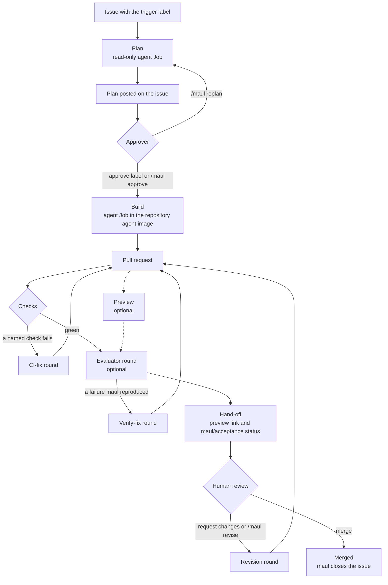
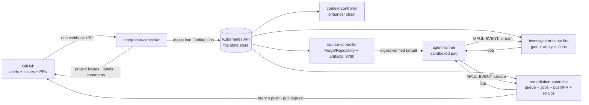

# How it works

Maul runs sandboxed coding agents on your own cluster and turns their work into pull requests that humans review and
merge. It has two flows:

- **Intents** start from a person. Someone describes a change in a GitHub issue, an agent plans it, an approver approves
  the plan, and an agent builds it and opens a pull request. [The intent flow](#the-intent-flow) below follows one.
- **Findings** start from a scanner. Security alerts arrive by webhook, an agent investigates each one, and confident
  fixes become pull requests while everything else goes to a human. [The findings flow](#the-findings-flow) below
  follows one.

This page follows each flow from start to end. If a word here is new, [Concepts](concepts.md) defines it.

## What both flows share

Both flows run on the same parts:

| Part                  | What it does                                                                                                    |
| --------------------- | --------------------------------------------------------------------------------------------------------------- |
| **source-controller** | Downloads a repository at one commit and serves it inside the cluster as an archive with a checksum.            |
| **The agent Job**     | A short-lived Kubernetes Job that runs one agent stage in a sandboxed pod. `agent-runner` drives the agent.     |
| **The egress broker** | A proxy inside the cluster that holds the model credential. Claude and Codex agents reach the model through it. |
| **The status server** | The web page where people watch findings and intents.                                                           |
| **The `maul` CLI**    | The same views and actions from a terminal, with your own Kubernetes access.                                    |

Three rules hold in both flows:

- **Kubernetes holds all the state.** The `maul.run/v1alpha1` custom resources carry everything maul knows. etcd is the
  only state store, and there is no shadow database or queue.
- **GitHub is a projection.** Issues, labels and comments are written from the resources. What people do on GitHub (a
  label, a `/maul` comment, a review, a merge) is read back as a signal. maul never rebuilds its state by parsing an
  issue.
- **The agent never talks to GitHub or the Kubernetes API.** It gets the code as an archive and hands its result back as
  a `MAUL-EVENT:` stream on its standard output. A controller reads that stream and does the writing.

There are two namespaces, and the split is the security boundary. The controllers run in `maul` (single replicas, leader
election as rollout insurance) alongside the egress broker and the status server. The ephemeral agent Jobs run in
`maul-agents`, which holds no model credential for the default claude runner at all: its model traffic authenticates at
the broker. See the [isolation model](deployment/isolation.md).

## The intent flow

An **intent** is one change a person asks for in a GitHub issue. The optional **intent-controller** runs the whole flow.
It does not take webhooks: it polls GitHub (every 60 seconds by default), so intents need no inbound address.

Intents are set up per **Project**. A Project names an _intent repository_ (where the issues are written), the
application repositories the changes are built in, and the _approvers_: the GitHub accounts whose actions count.
[Add a GitHub organization or a Project](intents/add-an-organization.md) creates one.



The `Project`, `Intent`, `IntentRun`, `Preview` and `PreviewVerification` resources carry this flow. Each `Intent` has a
phase, listed in [State machine & labels](labels.md#intent-phases).

### An issue starts an intent

Someone opens an issue in the intent repository, and an approver adds the Project's trigger label. By default that is
`maul:<project>`, so the Project `shop` uses `maul:shop`. The intent-controller finds the labelled issue on its next
poll and creates an `Intent` named `<project>-<issue number>`, such as `shop-42`.

The label counts only when GitHub shows that an approver applied it. A trigger from anyone else gets one refusal, and
the intent is closed before anything is planned.

If GitHub records the issue as _blocked by_ other issues, the intent waits until they are closed as completed. See
[Intent dependencies](intents/dependencies.md).

### An agent plans

The controller starts a **plan run**: an agent Job that reads the code and cannot change it. The agent writes a plan,
and maul posts it as a comment on the issue. The comment shows the plan's exact bytes in a code block, so what the
approver reads is what the build will receive.

### An approver approves the plan

An approver adds the approve label (`maul:approved` by default) or comments `/maul approve`. To ask for a different
plan, the approver comments `/maul replan <note>` or applies the trigger label again.

An approval counts only if it is newer than the plan comment, the plan comment is unchanged, and the issue still reads
as it did when the plan was made. Nothing is built before this step.

### An agent builds the approved plan

The controller starts a **build run**. It runs in the application repository's own _agent image_, which holds that
repository's toolchain, so the agent can run the build and the tests. The build receives only the approved plan, never
the issue.

The agent hands back a set of file changes. The controller checks them (a change that touches `.github/`, `.maul/` or
`.devcontainer/` is refused), pushes them to the branch `maul-intent/<intent>`, and opens the pull request. maul creates
that branch once and never force-pushes it. The pull request body says `Part of <intent repository>#<n>`.

### Rounds on the pull request

While the pull request is open, maul can run further agent runs on its head. Each one is called a round, and each pushes
a new commit to the same branch:

- **A revision round** starts when an approver submits a review that requests changes, or comments
  `/maul revise <what to change>` on the pull request.
- **A CI-fix round** starts when a check the Project names in `checks.fix` fails on a commit maul pushed. The agent
  reads the failure and tries to fix it.

Limits on the Project bound both kinds. [On the pull request](configuration/intent-controller.md#on-the-pull-request)
has the details.

### A preview (optional)

With the optional **preview-controller** on, and a Project that says how to run its application, each intent's pull
request is deployed inside the cluster and served at `https://<intent>.<host suffix>`, for example
`https://shop-42.preview.example.com`. The `Preview` resource carries it. It is removed when the intent ends, and it
expires 72 hours after its last deployment; the next push deploys it again.

[Set up previews](intents/set-up-previews.md) covers the setup.

### The evaluator checks the change (optional)

With the optional **agent evaluator** on, the plan also states **outcomes**: plain sentences that say what the change
must make true, such as "a player you add on the players page is listed there by the name you gave".

Once the pull request's checks are green and the preview serves exactly the pull request's commits, maul starts an
evaluator round:

1. An **evaluator** agent explores the running preview through a separate _tool pod_ and writes checks for the outcomes.
   The evaluator has no copy of the code and no network access beyond the broker and its tool pod.
2. maul runs each check again itself, without a model.
3. A second model, the **check reviewer**, says whether each check proves its outcome.

An outcome is **confirmed** only on a check that passed when maul ran it and that the reviewer said proves the outcome.
The evaluator's own report never passes an outcome. Such checks are saved and replayed in later rounds.

A failure maul reproduced starts a **verify-fix round**, within a limit. Verification never blocks the intent: a
person's review, command or push always wins. maul reports the result as the `maul/acceptance` commit status on the pull
request.

A Project with no preview can be evaluated too, if it builds a command-line program or a Go library.
[The agent evaluator](intents/evaluator.md) describes a round in full, and
[Acceptance verification](intents/acceptance.md) covers turning it on.

### The hand-off

The **hand-off** is the moment maul gives people the preview link and says whether the change is ready.

- Without the evaluator, the link is posted as soon as the preview is live.
- With the evaluator, the default mode is `gated`: maul holds the link until every outcome is confirmed or accepted by
  an approver, or until it gives up and says why. It waits at most 60 minutes by default. The other mode, `early`, posts
  the link at once and labels it as still being checked.

A person can always get the link sooner: `/maul preview` releases it. See
[The hand-off](intents/evaluator.md#the-hand-off).

### A person merges

maul never merges a pull request. When a person merges it, the intent becomes `Merged` and maul closes the issue. When a
person closes the issue or comments `/maul cancel`, the intent becomes `Closed`. An ended intent is kept for 14 days by
default and then deleted.

Watch intents from the cluster:

```sh
kubectl get projects,intents -n maul    # each Project, and each intent's phase and pull requests
kubectl get intentruns -n maul          # one row per agent run: stage, round, phase, outcome, cost
kubectl get previews -n maul            # each preview's phase and URL
```

## The findings flow

Findings are driven by five controllers. Webhooks enter through one door: the GitHub App's single webhook URL points at
the **integration-controller**'s `/github/webhooks` receiver, which validates each delivery against the webhook secrets
of your configured `Integration` resources. No other controller in this flow faces the internet, and no other controller
serves a webhook. Pipeline progress is **not** webhook-driven — the gates ("accumulation closed", "older than an hour",
"a free remediation slot") are conditions no event can announce, so the controllers' watch-driven reconcile loops carry
the pipeline; the webhook path is ingestion and human-in-the-loop signals only.

The resources of this flow are `Integration`, `Forge`, `Finding`, `Repository`, `Investigation`, `Remediation` and
`FindingRollup`.



### 1. Findings arrive and accumulate

The **integration-controller** validates each `code_scanning_alert` delivery and hands it to the matching
[`pkg/source` handler](extending.md), which normalizes the alert into advisories (GHSA/CVE/CWE), severity, and
locations; the GHAS handler ingests only alerts on the repository's default branch, so alerts CodeQL raises on
remediation PR branches never become findings. CodeQL can reopen an alert from an analysis that uploads after a newer
commit's already fixed it; when that analysis is of a commit older than the merged fix of the alert's latest Finding,
and the fix is still on the branch, the reopen is set aside on that Finding (`status.staleObservations`) instead of
opening a successor. A reopen at or after the fix (a regression) opens a successor. GitHub reports an alert only when
its state changes, so a regression found by a later analysis of an alert already open sends nothing: the controller
re-reads each set-aside alert until it closes, and opens the successor itself once the alert is seen at a commit the fix
does not supersede. The result is folded into a `Finding` resource: a new one at phase `Opened` for a first alert, or —
for the **accumulation window** (one hour by default) — merged into the existing Finding for the same repository and
advisory family. Accumulation is a condition (`AccumulationComplete`), not a phase, so alerts keep folding in while
enhancement runs concurrently. Alerts arriving after the window close open a fresh Finding.

### 2. The tracking issue is a projection

The same controller projects every Finding out as a GitHub tracking issue — body, enrichment and report comments, and a
trimmed [label vocabulary](labels.md#the-projected-labels) (source, advisories, phase, severity, priority,
recommendation). The projection is one-way: nothing ever parses issue state back into the pipeline. Human signals do
flow back — an issue closed by a human hands the finding off (in review, only if GitHub does not report its PR closed),
a `/maul approve` comment releases a held finding, and the merge of the finding's recorded PR completes it.

### 3. Context before code

The **context-controller** watches for `Opened` findings and runs the enhancer chain — ownership and infrastructure
context recorded as enrichments on Finding status (projected as issue comments by the integration-controller), then the
`Opened → Enhanced` transition. It holds no GitHub credential. The chain runs in a fixed order: the cloud lookups
([Google Cloud labels](integrations/enhancers/google-cai.md), [AWS resource tags](integrations/enhancers/aws.md),
[Azure resource tags](integrations/enhancers/azure.md)), then the
[generic HTTP enhancer](integrations/enhancers/generic.md), then a static YAML file that maps repositories to owners.
Each entry stands aside unless an `Integration` (or, for the static file, a flag) turns it on, and a failing enhancer
does not block the transition, with one exception: a cloud finding whose repository lookup failed is held at `Opened`
and retried, for at most the accumulation window. For a cloud finding, which names a resource and not a repository, the
cloud lookups are also what [resolve the repository](integrations/enhancers/index.md). The [`pkg/enhance`](extending.md)
seam takes further enhancers.

### 4. Repositories are pinned once

The **source-controller** runs the `Forge` and `Repository` reconcilers: it validates forge credentials, resolves each
Repository to its covering `Forge`, pins the head SHA exactly once, downloads the tarball archive at that SHA over plain
HTTP (no git binary anywhere controller-side), and serves it from an in-cluster artifact endpoint (`:9790`). Agent pods
fetch it **credential-lessly** — the URL carries an unguessable id and the Job pins the sha256 digest — so investigation
and remediation are guaranteed the same code.

### 5. The gate, then the investigation

The **investigation-controller** admits findings that are `Enhanced`, have a closed accumulation window, and are older
than `--finding-min-age` (one hour) — the age gate is the design's patience. Admission materializes the `Repository` and
one immutable `Investigation` per attempt (the child create is the lease), then the analysis scheduler runs agent Jobs
under bounded concurrency in severity order.

Inside the pod, **agent-runner** drives `claude -p` over the pinned tree and a templated finding handoff. The agent
writes a report with parseable YAML frontmatter: `exploitability`, `likelihood`, and `impact` ratings, a
`recommendation` (`ignore` | `remediate` | `manual`), `severity`, `priority`, a `confidence` value in [0, 1], and — for
`remediate` — the model it wants for the fix (clamped later to an operator allowlist) and its **estimate** of the turns
and tokens the fix will take. The estimate never shrinks the run: every remediation gets at least the operator's
ceiling. Estimating _above_ that ceiling instead holds the finding for a human `/maul approve`, and approving grants the
larger budget. Backwards-compatible fixes are always favoured; if a better-but-breaking fix exists, the report says so
and the pipeline holds the same way. The runtime never talks to GitHub or the Kubernetes API — results leave the pod as
a `MAUL-EVENT:` JSONL stream on stdout.

### 6. Verdicts route

The investigation-controller stamps the results onto the Finding (the report is projected onto the tracking issue, and
the ratings feed a 0–100 scheduling priority) and routes:

| Verdict                                                 | Route                                                                            |
| ------------------------------------------------------- | -------------------------------------------------------------------------------- |
| `ignore` (false positive)                               | Dismiss the accumulated alerts, close the issue — `Dismissed`                    |
| `manual`                                                | Hand to the repository owners — `HandedOff` (revivable by `/maul approve`)       |
| `remediate`, confidence < threshold, or a breaking hold | `AwaitingApproval` — a human `/maul approve` comment releases it                 |
| `remediate`, confidence ≥ threshold (0.75)              | `Queued` for remediation                                                         |
| Stage failed (timeout, budget, invalid report, …)       | Retry within `--max-attempts`, then `Failed` — a partial report is never trusted |

A retry is not a blind re-run. The controller that creates it — the investigation gate or the remediation spawner —
copies the failed attempt's outcome and detail onto the new Investigation or Remediation as `spec.previousAttempt`, and
the prompt quotes it (for `commit_failed`, the `git status` the runner found after `commit.sh`) as bounded, fenced,
untrusted data, so the agent is told what went wrong instead of being handed the inputs that already failed.

### 7. Remediation in priority order

The **remediation-controller** admits queued findings (including approvals and revivals), schedules them in priority
order under bounded concurrency (with aging so low-priority findings cannot starve), and runs the second agent stage:
the finding markdown, the same pinned tree, and the investigation report, under the budget the spawner granted. The
agent emits a summary report plus a `commit.sh` that must run cleanly and leave real commits — the claim is verified,
not believed.

The agent is asked to prove the bug before fixing it: write the regression test first, run it against the unfixed code
and see it fail for the expected reason, then apply the fix and see the same test pass. The report's `reproduction`
block records the result: `reproduced`, the test command, and short excerpts of the output before and after the fix
(each cut to 2000 bytes, the command to 500). The pull request says plainly whether the agent reproduced the bug and
quotes that evidence; when it reports it could not, or the report has no `reproduction` block, the pull request opens
with a warning that maul could not reproduce the bug before fixing it. The result is also recorded on the Remediation's
`status.reproduction`. **These fields are the agent's own account.** maul does not run the test itself, so they tell the
reviewer what to check, not what was checked. A remediation on maul's default image cannot run the repository's tests at
all; its pull request says so too, and a reproduction the agent claims there is not accepted: the pull request carries
the could-not-reproduce warning and quotes the claim as unverified. `status.reproduction` keeps the agent's account as
reported; read it beside `status.runnerImage`. The block is optional, so a report without it is still valid, and no
reproduction result holds a finding: every pull request already waits for a human merge.

The controller — the only holder of a forge **write** credential — then replays the changeset through the GitHub Git
Data API (blob → tree → commit → ref) onto a `maul/<finding>` branch, opens the pull request, and moves the finding to
`InReview`.

Everything the agent writes is untrusted, so none of it reaches GitHub as it was written. The report, in the pull
request body and in the tracking issue's report comments, is shown as text: links, images, raw HTML, hidden markup and
tables are shown literally rather than rendered, mentions and issue references (closing keywords included) become inline
code, and characters that render as nothing are shown by their code point. Headings, lists, emphasis and code blocks
still render. The pull request body and the agent's commit message can also land on the default branch as plain text, so
every mention and issue reference in them is broken apart as well (`# 7`, `@ name`): the only issue the pull request
closes is the tracking issue, through maul's own `Fixes #N`. A report that would take a body or comment past GitHub's
size limit is cut and says so.

### 8. Humans close the loop

Merging the PR fires a `pull_request` webhook: the integration-controller moves the finding to `Remediated`. Closing the
PR unmerged, or exhausting retries anywhere above, lands it at `Failed`; `manual` verdicts and human-closed issues land
at `HandedOff`, which a later `/maul approve` can revive back into the queue. The merge closes the tracking issue too
(`Fixes #N`), and the two webhooks arrive in either order, so an issue closed during review is checked against the PR
first: merged or closed, the PR's outcome applies; otherwise (still open, or unreadable) a human closed the issue, as
long as GitHub still reports it closed. Completed findings are kept for a TTL (14 days by default) and then deleted;
per-scope `FindingRollup` resources retain the all-time statistics — success rates, verdict mix, token and cost totals
per repository, harness, and model.

Watch it all with the shared kubectl category:

```sh
kubectl get maul -n maul          # everything maul owns
kubectl get findings -w               # the pipeline, live
kubectl get investigations,remediations,findingrollups
```

The complete phase table, with writers, lives in [State machine & labels](labels.md#phases).
