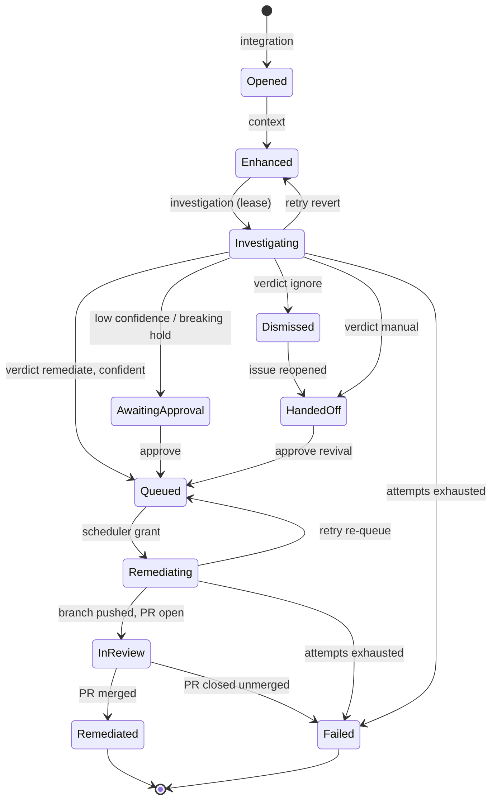
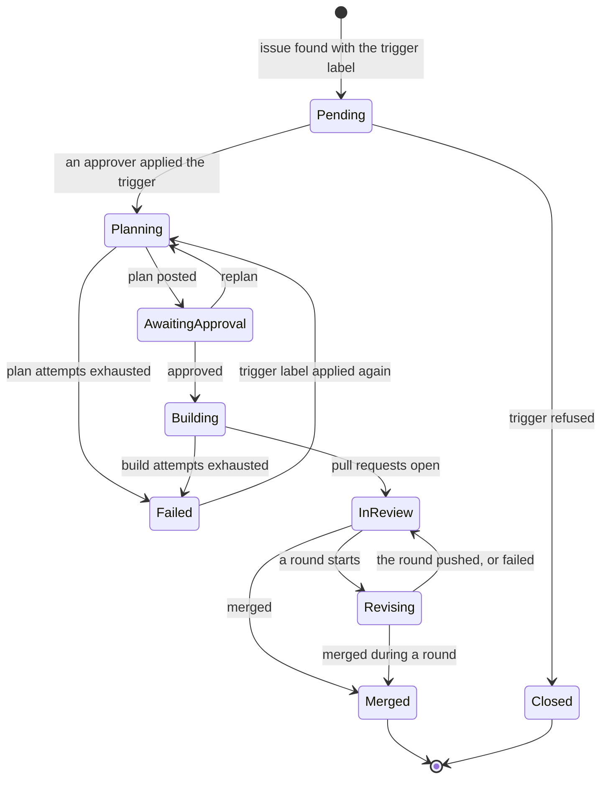

# State machine & labels

maul has two state machines, one per flow. A `Finding` carries the phase of one security finding, and an `Intent`
carries the phase of one requested change. This page covers Findings first, then [Intents](#intent-phases).

The `Finding` custom resource is the authoritative state machine for one security finding. `api/v1alpha1` owns the phase
taxonomy and the legal transition table (`transitions.go`), every phase edge has exactly one writer component, and
`SetPhase` refuses illegal moves — a controller cannot accidentally invent a transition. Labels on the tracking issue
are a **one-way projection** of this state for humans and issue searches; nothing ever parses them back.

## Phases

`Finding.status.phase` walks the happy path
`Opened → Enhanced → Investigating → Queued → Remediating → InReview → Remediated`, with `AwaitingApproval` before
`Queued` when a human must approve, and `Dismissed` / `HandedOff` / `Failed` as the other terminal phases. `Queued` is a
real phase — remediation runs in priority order with bounded concurrency, so findings observably wait for a slot.

| Phase              | Meaning                                                                                 |
| ------------------ | --------------------------------------------------------------------------------------- |
| `Opened`           | Ingested from the first alert; accumulating, awaiting enhancement                       |
| `Enhanced`         | The enhancer chain ran; ownership / infrastructure context recorded                     |
| `Investigating`    | An `Investigation` child exists (the child create is the lease); analysis Job runs      |
| `AwaitingApproval` | Verdict is `remediate` but below the confidence threshold, or a breaking-change hold    |
| `Queued`           | Admitted to the remediation queue; waiting for a priority-ordered slot                  |
| `Remediating`      | A `Remediation` child holds a slot; the remediation Job runs                            |
| `InReview`         | Branch pushed, pull request open; humans review                                         |
| `Remediated`       | PR merged. **Terminal**                                                                 |
| `Failed`           | Retries exhausted, fatal stage outcome, or PR closed unmerged. **Terminal**             |
| `Dismissed`        | Investigation verdict `ignore`: alerts dismissed, issue closed. **Terminal**, revivable |
| `HandedOff`        | Verdict `manual`, or a human closed the tracking issue. **Terminal**, revivable         |

Terminal entry sets `status.completedAt`, which starts the [finding TTL](configuration/remediation-controller.md)
(default 14 days — the `FindingRollup` objects retain the statistics after deletion). `Dismissed` and `HandedOff` are
revivable terminals: reopening the issue moves `Dismissed → HandedOff`, and an approval (`/maul approve` on the issue,
or the status page or CLI) moves `HandedOff → Queued`, clearing `completedAt` and cancelling the TTL.

## Legal transitions

Self-transitions are always legal no-ops; everything else is refused by `SetPhase`. Per-edge ownership means no phase
edge has two writers.



Every non-terminal phase additionally has an edge to `HandedOff`, written by the integration-controller when a human
closes the tracking issue — a person can always pull a finding out of the machine's hands.

| Edge                                                                                   | Writer                   | Trigger                                                              |
| -------------------------------------------------------------------------------------- | ------------------------ | -------------------------------------------------------------------- |
| _(none)_ → `Opened`                                                                    | integration-controller   | First alert of an advisory family for a repository                   |
| `Opened` → `Enhanced`                                                                  | context-controller       | Enhancer chain completed                                             |
| `Enhanced` → `Investigating`                                                           | investigation-controller | Gate admits (accumulation closed ∧ min age); `Investigation` created |
| `Investigating` → `Enhanced`                                                           | investigation-controller | Recoverable Job failure with attempts left                           |
| `Investigating` → `Queued` / `AwaitingApproval` / `Dismissed` / `HandedOff` / `Failed` | investigation-controller | Verdict routing                                                      |
| `AwaitingApproval` → `Queued`, `HandedOff` → `Queued`                                  | remediation-controller   | Accepted approval: release / revival                                 |
| `Queued` → `Remediating`                                                               | remediation-controller   | Priority scheduler grants a slot                                     |
| `Remediating` → `Queued`                                                               | remediation-controller   | Recoverable failure re-queued                                        |
| `Remediating` → `InReview` / `Failed`                                                  | remediation-controller   | Push + PR succeeded / attempts exhausted                             |
| `InReview` → `Remediated` / `Failed`                                                   | integration-controller   | The recorded PR merged / closed unmerged (see below)                 |
| `Dismissed` → `HandedOff`                                                              | integration-controller   | Human reopened the tracking issue                                    |
| any non-terminal → `HandedOff`                                                         | integration-controller   | Human closed the tracking issue (in review: see below)               |

In review, only the finding's recorded PR settles it — the same number, in the finding's repository, from a branch
there, not a fork's. The PR body's `Fixes #N` closes the tracking issue as the PR merges, and the two deliveries arrive
in either order, so an issue closed during review is checked against the recorded PR: merged → `Remediated`, closed
unmerged → `Failed`. Still open, or unreadable (GitHub answers 404 or 403, or no PR is recorded) → `HandedOff`, but only
if GitHub still reports the tracking issue closed: a close and a quick reopen can be delivered reopen first. A PR close
from a repository other than the recorded one — renamed since — is confirmed against the recorded PR: merged or closed,
its outcome applies; still open or unreadable, nothing moves. A transfer to another owner is confirmed the same way only
while the Integration's credential can still read the repository under its old name (a public repository, or an App
installation on the old owner that still includes it); otherwise GitHub answers 404 and the finding stays `InReview` for
a human. Either close is kept on the finding as `ReviewClosePending` until GitHub answers, because GitHub never
redelivers a webhook it has already delivered — and while no issues-enabled Integration exists to read it through
(suspended, issues turned off, or deleted), the close waits for one.

## Conditions

Facts that are not phases ride on `status.conditions`. Accumulation is the important one: alerts keep folding into a
Finding **while** enhancement runs, so the window close cannot be a phase.

| Condition                                               | On                         | Meaning                                                                                                     |
| ------------------------------------------------------- | -------------------------- | ----------------------------------------------------------------------------------------------------------- |
| `Ready`                                                 | every kind                 | The summary condition                                                                                       |
| `Stalled`                                               | every kind                 | Cannot progress without operator action (ambiguous forge match, oversized artifact)                         |
| `AccumulationComplete`                                  | Finding                    | The accumulation window closed; the gate may admit                                                          |
| `ContextEnhanced`                                       | Finding                    | The enhancer chain ran                                                                                      |
| `Investigated`                                          | Finding                    | Analysis completed; the reason carries the recommendation                                                   |
| `Approved`                                              | Finding                    | A human approval (`/maul approve`, the status page or the CLI) was accepted                                 |
| `ForgeResolved`                                         | Finding                    | The repository resolved to exactly one Forge (`False` reasons: `NoRepository`, `NoForgeMatch`, `Ambiguous`) |
| `ReviewClosePending`                                    | Finding                    | A close seen in review awaits the recorded PR's state (`TrackingIssueClosed`, `UnrecordedRepository`)       |
| `TrackingUnavailable`                                   | Finding                    | GitHub refuses the tracking issue (`IssuesDisabled`); re-tried every 6 hours, the pipeline goes on          |
| `Complete`                                              | Investigation, Remediation | The stage finished; the reason carries the outcome                                                          |
| `RolledUpTotal` / `…Repository` / `…Harness` / `…Model` | Finding                    | Per-scope rollup accounting markers (exactly-once, finalizer-backed)                                        |
| `UsageRolledUp`                                         | every run kind             | The run's usage is in its `UsageRollup`s (reason `Aggregated`, or `RollupForbidden`); attributed runs only  |

Findings parked with `ForgeResolved: False` are re-queued automatically when `Forge` resources change. A finding can
also be paused by a human: `spec.suspend: true` halts pipeline progress until cleared. A suspended finding accepts no
new alerts: a new alert of its family opens a successor generation (its own tracking issue, linked `successor-of` the
suspended one), exactly as for a finding already past accumulation, so nothing is absorbed where nobody sees it. An
alert the suspended finding already holds stays deduplicated there.

## Watching it

```sh
kubectl get maul -n maul                        # every maul kind, one shot
kubectl get findings -w                             # phase, severity, priority, verdict, live
kubectl get investigations                          # per-attempt analysis children (short name: inv)
kubectl get remediations                            # per-attempt remediation children (rem)
kubectl get findingrollups                          # the all-time statistics (fr)
kubectl describe finding <name>                     # conditions, phase log, enrichments, attempts
```

Machine metadata that used to ride on issue labels — alert numbers, accumulation state, confidence, budgets, attempt
counts, per-stage token/cost accounting — lives on these resources, nowhere else.

## The projected labels

The tracking-issue projection stamps a trimmed, human-facing vocabulary, rendered from the Finding by the
integration-controller (`internal/labels`). Every label is `<key>: <value>`, truncated to GitHub's 50-character cap; the
multi-valued advisory key emits one label per identifier. Maul only touches labels in the `security-` namespace, ignores
foreign or malformed `security-*` labels, and does not manage label colors or descriptions.

| Key                       | Cardinality        | Values                                                                                                                                                                      |
| ------------------------- | ------------------ | --------------------------------------------------------------------------------------------------------------------------------------------------------------------------- |
| `security-source`         | single             | The source handler that ingested the finding, e.g. `ghas`, `gcp-scc`, `wiz-issues`, `wiz-defend`, or a generic Integration's name                                           |
| `security-advisory`       | multi (one per id) | The CWE/CVE/GHSA identifiers                                                                                                                                                |
| `security-finding`        | single             | The phase, kebab-cased: `opened`, `enhanced`, `investigating`, `queued`, `awaiting-approval`, `remediating`, `in-review`, `remediated`, `dismissed`, `handed-off`, `failed` |
| `security-severity`       | single             | `low` \| `medium` \| `high` \| `critical` (scanner-assigned)                                                                                                                |
| `security-priority`       | single             | `low` \| `medium` \| `high` \| `critical` (derived from the investigation)                                                                                                  |
| `security-recommendation` | single             | `remediate` \| `ignore` \| `manual` (the investigation verdict)                                                                                                             |

That is the whole list — the projection is deliberately small. Labels exist for issue searches and human triage; the CR
is the state, so no machine or usage labels exist on issues anymore.

## Intent phases

An `Intent` is one change requested in an issue ([Concepts](concepts.md#intent) defines the words used here). Its phase
is in `Intent.status.phase`. The happy path is `Pending → Planning → AwaitingApproval → Building → InReview → Merged`.

The intent-controller is the only writer of every Intent phase. The table of legal moves is separate from the Finding's
(`intentTransitions` in `api/v1alpha1/intent_types.go`), and `SetIntentPhase` refuses any move that is not in it.

| Phase              | Meaning                                                                                                                       |
| ------------------ | ----------------------------------------------------------------------------------------------------------------------------- |
| `Pending`          | The issue was found with the trigger label. maul has not yet decided whether the person who applied it may start it.          |
| `Planning`         | A plan run is waiting, running, or having its plan posted on the issue.                                                       |
| `AwaitingApproval` | The plan is posted on the issue. maul waits for an approver to approve it or ask for a new plan.                              |
| `Building`         | The approved plan is being built, pushed and opened as pull requests.                                                         |
| `InReview`         | Every pull request is open. maul waits for reviews, checks and a merge.                                                       |
| `Revising`         | A round is running on the pull request: a revision, a CI fix, or a fix after a failed verification.                           |
| `Blocked`          | A limit or a missing precondition stops progress. The conditions say which. **Not terminal**: it resumes.                     |
| `Merged`           | Every pull request merged, and maul closed the issue as completed. **Terminal**                                               |
| `Closed`           | A person closed the issue or ran `/maul cancel`, a pull request was closed unmerged, or the trigger was refused. **Terminal** |
| `Failed`           | The plan or the build ran out of attempts, or the plan was invalid twice. **Terminal**, revivable                             |

Some things to know about these phases:

- **`Pending` can last.** An intent whose issue is [blocked by other issues](intents/dependencies.md) waits in `Pending`
  until they are closed as completed. That wait is the `WaitingOnDependencies` condition, not a phase.
- **A failed round does not fail the intent.** When a revision or CI-fix round fails, the intent goes back to
  `InReview`, a condition is set and a notice is posted.
- **`Blocked` remembers where it came from.** When the block no longer holds, the intent returns to the phase it was
  blocked from. maul checks again whenever the Project changes, so raising a limit resumes the intent.
- **`Failed` can be revived.** On entry to `Failed`, maul removes the trigger label from the issue. An approver applying
  it again starts a new plan, which needs a new approval.
- **A person can end an intent from any phase.** Closing the issue, or `/maul cancel`, moves any non-terminal phase to
  `Closed`. Merging every pull request moves `InReview`, `Revising` or `Blocked` to `Merged`.

Entering a terminal phase sets `status.completedAt`, which starts the intent's time to live (14 days by default,
`--intent-ttl` on the [intent-controller](configuration/intent-controller.md)). A revival clears it. A `Blocked` intent
never expires while it waits.

## Intent transitions

Self-transitions are legal no-ops, as for Findings.



Two sets of edges are left out of the diagram to keep it readable:

- every non-terminal phase has an edge to `Blocked`, and `Blocked` has an edge back to each of them, and to `Merged`;
- every non-terminal phase, `Blocked` included, has an edge to `Closed`.

| Edge                                           | Trigger                                                                                |
| ---------------------------------------------- | -------------------------------------------------------------------------------------- |
| _(none)_ → `Pending`                           | The intent-controller found an issue carrying the trigger label                        |
| `Pending` → `Planning`                         | The trigger label was applied by an approver                                           |
| `Pending` → `Closed`                           | The trigger was not an approver's, or was a bot's; one notice is posted                |
| `Planning` → `AwaitingApproval`                | A valid plan was posted on the issue                                                   |
| `Planning` → `Failed`                          | Plan attempts exhausted, or the plan was invalid twice                                 |
| `AwaitingApproval` → `Building`                | An approval was accepted (the approve label or `/maul approve`)                        |
| `AwaitingApproval` → `Planning`                | An approver asked for a replan (the trigger label again, or `/maul replan`)            |
| `Building` → `InReview`                        | Every pull request is open                                                             |
| `Building` → `Failed`                          | Build attempts exhausted                                                               |
| `InReview` → `Revising`                        | A revision, CI-fix or verify-fix round started                                         |
| `Revising` → `InReview`                        | The round pushed, or failed                                                            |
| `InReview` / `Revising` / `Blocked` → `Merged` | Every pull request merged                                                              |
| any non-terminal → `Blocked`                   | A limit or a precondition stopped it                                                   |
| `Blocked` → the phase it was blocked from      | The Project changed and the block no longer holds                                      |
| any non-terminal → `Closed`                    | A person closed the issue or ran `/maul cancel`, or a pull request was closed unmerged |
| `Failed` → `Planning`                          | Revival: an approver applied the trigger label again                                   |

## Why an intent is Blocked

A `Blocked` intent carries one or more conditions that say why. The [intents dashboard](intents/dashboard.md) shows each
one in a fixed public wording, given below. The wording never includes a condition's own message or a person's name; the
intent's issue and `kubectl describe intent <name>` can say more.

| Condition                 | Reason                     | Shown as                                                                     |
| ------------------------- | -------------------------- | ---------------------------------------------------------------------------- |
| `BudgetExhausted`         |                            | spent `$X` of the `$Y` cost ceiling                                          |
| `RevisionLimitReached`    |                            | the revision limit is reached (`N` of `M`)                                   |
| `ChecksFailing`           | `MaxCheckFixes`            | the check-fix limit is reached (`N` of `M`)                                  |
| `ChecksFailing`           | `RepeatedFailure`          | the same check failure came back after a fix round                           |
| `ImageRequired`           | `NoRepositoryImage`        | the repository declares no agent image, and builds need one                  |
| `ImageRequired`           | `RepositoryImageRejected`  | the repository's agent image was rejected                                    |
| `ImageRequired`           | `RepositoryImagesDisabled` | repository agent images are turned off on this cluster                       |
| `ImageRequired`           | `SandboxBreakerTripped`    | the sandbox breaker tripped: an agent image failed the sandbox probe         |
| `ImageRequired`           | `DefaultImageRan`          | the build ran on the default image instead of the repository's               |
| `BranchConflict`          | `BranchExists`             | the intent branch exists at a commit maul did not push                       |
| `BranchConflict`          | `ForeignPullRequest`       | a pull request maul did not open holds the intent branch                     |
| `BranchConflict`          | `BranchMissing`            | the intent branch vanished before its pull request opened                    |
| `BranchConflict`          | `BranchChanged`            | the intent branch moved away from the build's commit                         |
| `BranchConflict`          | `PullRequestRefused`       | GitHub refused to open the pull request                                      |
| `BranchConflict`          | `StaleRoundBranch`         | the intent branch holds an earlier round's commit                            |
| `UnsupportedRepositories` | `MultiRepositoryOff`       | the project lists several repositories, and multi-repository intents are off |
| `UnsupportedRepositories` | `RepositoryKeyChanged`     | the project's repository keys changed during a build                         |
| `ResourcesUnavailable`    | `UnknownResourceClass`     | the repository asks for a resource class the cluster does not define         |
| `ResourcesUnavailable`    | `Unschedulable`            | no node in the cluster could fit the agent                                   |
| `CredentialRequired`      | `CredentialMissing`        | the person the next run is for has no model credential stored                |
| `CredentialRequired`      | `CredentialRejected`       | the model credential of the person the next run is for was rejected          |
| `CredentialRequired`      | `CredentialUnverified`     | the model credential of the person the next run is for is not verified yet   |
| `ModelNotAllowed`         |                            | the project chooses a model the cluster does not run its intents on          |

What clears the most common ones:

- **`BudgetExhausted`**: the intent's spend reached the Project's `limits.maxCostMicroUSD` (\$10 by default). Raise the
  limit on the Project.
- **`RevisionLimitReached`**: the intent used the Project's `limits.maxRevisions` revision rounds (3 by default). Raise
  the limit. Merging the pull request also ends the block: the intent becomes `Merged`.
- **`ChecksFailing`**: CI-fix rounds did not fix a failing check, either because the same failure came back or because
  `limits.maxCheckFixes` (2 by default) is used up. It holds the intent for a person, and is looked at again when the
  Project changes.
- **`ImageRequired`**: the build has no accepted agent image to run in. Declare or fix the repository's image; see
  [Bring your own agent image](integrations/agent-images.md).
- **`BranchConflict`**: the branch `maul-intent/<intent>` is not in a state maul will build on. Nothing is forced; for
  `BranchExists`, `ForeignPullRequest` and `StaleRoundBranch` the block lifts once the branch, or that pull request, is
  gone.
- **`CredentialRequired`**: only where the operator requires each person's own model credential. It lifts once that
  person's credential is valid; see [Your model credential](account.md).

Two conditions look like blocks and are not:

- **`WaitingOnDependencies`** holds an intent in `Pending` while its issue is blocked by other issues. The dashboard
  shows it as a waiting badge, for example "waiting for the issues it is blocked by".
- **`VerifyFailing`** marks an intent whose [acceptance verification](intents/acceptance.md) fails and will not be fixed
  automatically. The intent stays in review, and the `maul/acceptance` status reports the failure.

## Watching intents

```sh
kubectl get intents -n maul -w                   # project, issue, phase, pull requests, revisions, cost
kubectl get intentruns -n maul                   # per-attempt agent runs (short name: irun)
kubectl describe intent <name> -n maul           # conditions and phase times
```

## Intent labels

Intents do not use the `security-` labels above. An intent's issue is driven by two labels that people apply, both named
on the Project:

| Label             | Default          | Meaning                                                                                            |
| ----------------- | ---------------- | -------------------------------------------------------------------------------------------------- |
| The trigger label | `maul:<project>` | Starts an intent from the issue. Applied again, it asks for a replan or revives a `Failed` intent. |
| The approve label | `maul:approved`  | Approves the posted plan. The comment `/maul approve` does the same.                               |

Both count only when an approver applied them. maul removes the trigger label when an intent fails or when the trigger
was refused, and removes an approve label it refused.
