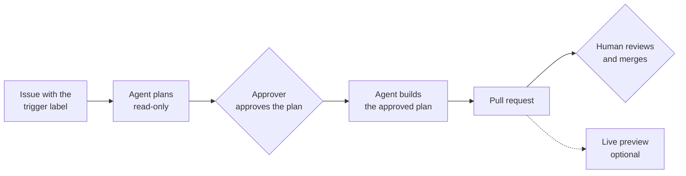

# What is maul

maul runs AI coding agents (Claude Code, and Codex if you turn it on) on your own Kubernetes cluster. You describe a
change in a GitHub issue. An agent plans it, a person approves the plan, an agent builds it and opens a pull request,
and a person reviews and merges it.

Each agent runs in a sandboxed pod: a short-lived Kubernetes Job that holds no GitHub credential and no model key.
Everything maul knows is stored in Kubernetes resources. GitHub issues and pull requests are where people read the work
and answer it.

This page explains what maul does, how it keeps agents contained, and what you need to run it. To install it, go to the
[quick start](getting-started/quick-start.md).

## The two flows

maul has two flows. They share the same parts: the sandboxed agent Job, the broker that holds the model credential, the
status page and the `maul` command-line tool. You can run either flow, or both.

### Intents: an issue becomes a pull request

An **intent** is a change someone asks for in a GitHub issue. This is the flow most installs start with.

1. **Someone opens an issue** in the _intent repository_, the repository where requests are written. An approver adds
   the Project's trigger label, `maul:<project>`.
2. **An agent plans the change.** It reads the code but cannot change it, and maul posts its plan as a comment on the
   issue.
3. **An approver approves the plan**, with the approve label or the comment `/maul approve`. Approvers are the GitHub
   accounts a Project names. A label or command from anyone else is refused.
4. **An agent builds exactly that plan**, in an image that holds the application's own toolchain, so it can run the
   application's build and tests.
5. **maul opens the pull request.** The agent never talks to GitHub. A controller pushes the branch and opens the pull
   request.
6. **A person reviews and merges it.** maul closes the issue when the pull request merges.

While the pull request is open, maul can run further rounds on it:

- **Revision rounds.** An approver's review that requests changes, or the comment `/maul revise <what to change>` on the
  pull request, starts a new agent run on the pull request's head.
- **CI-fix rounds.** When a check the Project names fails on a commit maul pushed, an agent reads the failure and tries
  to fix it.

Both are bounded by limits on the Project. [The intent-controller page](configuration/intent-controller.md#on-the-issue)
describes every action on the issue and the pull request.

Two optional parts build on intents:

- **Previews.** Each intent's pull request is deployed at a URL of its own, `https://<project>-<issue>.<host suffix>`,
  behind sign-in. It is removed when the intent ends, and it expires 72 hours after its last deployment; the next push
  deploys it again. See [Set up previews](intents/set-up-previews.md).
- **The agent evaluator.** The approved plan states _outcomes_ in plain words. Once the pull request's checks are green,
  an evaluator agent tests the change in its preview against those outcomes, and maul reports the result as the
  `maul/acceptance` commit status. See [The agent evaluator](intents/evaluator.md).

### Findings: a security alert becomes a fix

A **finding** is a security alert from a scanner. This flow is optional and independent of intents.

Alerts arrive by webhook from GitHub code scanning (CodeQL), Google Cloud Security Command Center, Wiz, or any system
that can send HTTP through the generic integration. maul groups them into `Finding` resources and opens a tracking issue
for each. An agent investigates every finding:

- a false positive is dismissed;
- a fix the agent is confident about is built and opened as a pull request;
- everything else is handed to a person.

[How it works](how-it-works.md) follows a finding from alert to pull request.

## How agents are contained

An agent reads code and text that maul does not control, so maul treats every agent as untrusted. These are the main
controls.

- **No credentials in the agent pod.** A Claude or Codex agent pod holds no GitHub token and no model key. Model
  requests go through the _egress broker_, a proxy inside the cluster that adds the model credential on the way out. The
  pod proves who it is to the broker with a short-lived Kubernetes token that works nowhere else.
- **The agent never talks to GitHub.** The repository arrives in the pod as an archive whose checksum is verified. The
  agent hands back a set of file changes, and a controller pushes them with a short-lived token scoped to one
  repository.
- **A person approves and a person merges.** No intent is built before an approver approves its plan, and maul does not
  merge pull requests.
- **An agent cannot change its own sandbox.** A build's changes are refused if they touch `.github/`, `.maul/` or
  `.devcontainer/`.
- **Previews are isolated from each other.** Each preview gets its own host name, so one preview's page cannot read
  another's cookies or storage, and a preview pod can reach DNS and, when the evaluator is on, only the other parts of
  its own preview it declares; nothing outside its slot.

One runner is an exception to the first point. The optional Copilot runner, which is off by default, carries a GitHub
token in its pod. [The isolation model](deployment/isolation.md) describes every layer in detail.

## Where the state lives

maul keeps all of its state in Kubernetes custom resources, such as `Project`, `Intent` and `Finding`. There is no
database to run. GitHub issues, labels and comments are written from those resources. What people do on GitHub (a label,
a `/maul` comment, a review, a merge) is read back as a signal.

You can see the same state in three places: on GitHub, on the [status page](status-ui.md), and with the
[`maul` CLI](cli.md), which uses your own Kubernetes access.

## What you need

| You need                                                 | Why                                                                                                                                                                                                            |
| -------------------------------------------------------- | -------------------------------------------------------------------------------------------------------------------------------------------------------------------------------------------------------------- |
| A Kubernetes cluster, version 1.34 or later              | maul is installed with a Helm chart, and that is the chart's minimum version.                                                                                                                                  |
| A network plugin that enforces `NetworkPolicy`           | The agent sandbox and the preview isolation are network policies. On a cluster that does not enforce them, they do nothing.                                                                                    |
| Helm 3.8 or later                                        | The charts are published to an OCI registry.                                                                                                                                                                   |
| A GitHub organization you are an Owner of                | maul signs in to GitHub as a GitHub App. GitHub lets only an Owner create an organization's App. A personal account works too.                                                                                 |
| A model credential                                       | An Anthropic API key or a `claude setup-token` token, or access through Amazon Bedrock, Google Vertex AI or Microsoft Foundry. See [the provider recipes](deployment/helm.md#model-providers-brokered-claude). |
| For intents: a container registry                        | Each application repository declares an _agent image_ holding its toolchain, and the cluster pulls it from a registry you choose.                                                                              |
| For findings: a scanner, and an HTTPS address for GitHub | Alerts arrive by webhook, so GitHub must be able to reach maul. Intents poll GitHub and need no inbound address.                                                                                               |
| For previews: DNS names, a certificate and Dex           | A wildcard DNS name for the preview hosts, a certificate for it, and [Dex](https://dexidp.io/) for sign-in. [Set up previews](intents/set-up-previews.md#what-every-install-needs) lists them.                 |

## Where to go next

- **[Quick start](getting-started/quick-start.md)**: install maul with intents and open your first issue.
- **[Getting started](getting-started/index.md)**: choose between the intents and the findings path.
- **[How it works](how-it-works.md)**: the parts and how they fit together.
