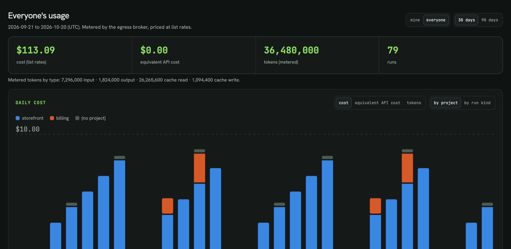

# Costs and usage

Every claude and codex agent run sends its model traffic through maul's [egress broker](configuration/egress-broker.md),
so maul can count what each run spends. This page explains where you can see that spend, what the numbers mean, which
limits stop a run from spending too much, and how to charge runs to the people who started them. Each section links to
the reference page that has the details.

[Concepts](concepts.md) explains the words Project, intent and Finding used below.

Two words come up throughout:

- **Tokens** are what a model API bills by. A run's tokens come in four kinds: input, output, cache reads (the part of
  the conversation the model has already seen, re-sent on every turn) and cache writes.
- **Cost** is those tokens priced at the model's list rates. maul records it in micro-USD: `10000000` is \$10.

## Where to see spend

| Where                                                    | What it shows                                                      | Needs                                                       |
| -------------------------------------------------------- | ------------------------------------------------------------------ | ----------------------------------------------------------- |
| The [intents dashboard](intents/dashboard.md)            | Each intent's recorded spend against its cost ceiling, and per run | `statusServer.intents.enabled`                              |
| An intent's status comment on its issue                  | The intent's reported cost against its limit                       | nothing extra                                               |
| The status page's Rollups view                           | All-time token and cost totals of Finding runs, per stage          | nothing extra; this view is public                          |
| The status page's [Usage page](#the-usage-page)          | Daily spend per person, per Project and per run kind               | `attribution.mode: attribute`, `statusServer.usage.enabled` |
| [`maul get usage`](cli.md#reading-usage)                 | The same report as the Usage page, in a terminal                   | the same, plus the `usage/all` grant                        |
| The broker's audit log                                   | Each request's tokens and cost, and the pod's running total        | nothing extra                                               |
| The `maul.broker.cost` and `maul.broker.tokens` counters | Spend by route, metered or estimated                               | nothing extra                                               |

The dashboard and the status comment show **recorded** spend: the figure each run reported when it ended. A run's spend
appears when it ends; there is no live figure while it runs. That figure comes from the agent pod itself. A run on a
[repository-declared agent image](integrations/agent-images.md) runs code the repository controls, so its own report
cannot be fully trusted. The broker meters the same traffic from outside the pod, and its count is the trustworthy one.
With [attribution](#who-a-run-is-for) on, each run also records the broker's figure, and the Usage page uses only that.

## The Usage page



_Sample data._

The Usage page answers "who is spending what". Every signed-in person sees their own daily cost and tokens over the last
30 or 90 days, stacked by Project or by run kind (plan, build, revise and so on), and their most expensive intents. A
person granted `get` on the virtual `usage/all` subresource sees everyone's, can open one person or one Project, and
sees the runs no person is behind (the organisation's).

How to read it:

- **Cost leads.** A token total is mostly cache reads, which cost a tenth of an input token, so the token count of a
  long run looks far larger than its cost. The page opens on cost; tokens are a toggle away, split by kind.
- **Only metered figures are totalled.** Runs that have only the pod's own report (no broker figure) and the broker's
  worst-case estimate for responses it could not read are shown in a panel of their own, never added to a total.
- **A subscription is not money spent.** Runs paid by a Claude subscription's `claude setup-token` credential are priced
  as an _equivalent API cost_: what they would have cost at list rates.

To turn it on you need run attribution (next section), sign-in through Dex with the GitHub connector, and
`statusServer.usage.enabled: true`. A person is identified by their GitHub numeric id, which the page reads from Dex's
`federated:id` scope. [status-server: Usage views](configuration/status-server.md#usage-views) has the exact
configuration and the API.

`maul get usage` prints the same report for administrators:

```sh
maul get usage                        # everyone, the last 30 days
maul get usage --since 90d
maul get usage --user octocat         # a GitHub login, github-id:<id>, or org
maul get usage --project storefront
```

It needs `get` on `usage/all` and read access to `usagerollups`; the chart's `<release>-usage-admin` ClusterRole
(`maul-usage-admin` for a release named maul), rendered when `statusServer.rbac.userRoles` and
`statusServer.usage.enabled` are both on, grants both. See [Reading usage](cli.md#reading-usage).

## Who a run is for

**Run attribution** records, on every agent run, the person whose decision started it. It is off by default; turn it on
with the chart value `attribution.mode: attribute`.

A run is attributed to:

- the approver who triggered an intent's plan (a plan triggered by someone who is not an approver is the
  organisation's);
- the plan's approver, for its build and CI-fix runs;
- the approver whose `/maul revise` or `/maul retry` started a revision round, or the author of the newest approver
  review a review round consumed;
- a Finding's approver, for a remediation that waited for that approval. Finding investigations, and remediations no one
  had to approve, are the organisation's;
- an evaluation unit is its submitter's, which for now always resolves to the organisation's.

A person is their GitHub numeric id, never their login, which can be renamed. An approval made on the status page or
with the CLI has no GitHub id behind it, so its runs are the organisation's.

With attribution on, maul also:

- records the broker's measured usage on each run beside the pod's own report (**trusted usage**);
- folds every finished run into `UsageRollup` objects, per person, per person and Project, and per Project, by day and
  by month. These outlive the runs, which expire after their time to live, and they are what the Usage page reads.
  `kubectl get usagerollups` lists them.

Admission policies make sure that only maul's own controllers decide whom a run is for, so an agent, or someone who can
create Jobs, cannot bill a run to someone else. [Run attribution](configuration/attribution.md) covers all of this,
including how to turn it on without refusing runs during the upgrade.

## Limits on spend

Several limits exist, and they bound different things. Only some of them are on by default.

| Limit                                                                   | What it bounds                                                                                                            | Default                                            |
| ----------------------------------------------------------------------- | ------------------------------------------------------------------------------------------------------------------------- | -------------------------------------------------- |
| A Project's `limits.maxCostMicroUSD`                                    | One intent's recorded spend, evaluator runs excepted, checked before maul starts each plan, build, revision or CI-fix run | \$10 per intent                                    |
| `limits.maxEvaluateCostMicroUSD`                                        | The evaluator's spend per intent; at it the round ends unconfirmed, nothing is Blocked                                    | \$6                                                |
| The broker's per-pod and hourly limits                                  | What one agent pod, or all pods in a trailing hour, may spend, enforced on every model request                            | off                                                |
| `limits.<stage>.maxCostMicroUSD` (stage: plan, build, revise, evaluate) | One run's budget, enforced by the broker                                                                                  | only with `egressBroker.limits.unit: cost` (below) |
| `limits.<stage>.tokenBudget` (the same stages)                          | Output tokens the agent streams; a tripwire against a runaway run, not a measure of spend                                 | set per stage by the chart                         |

**The per-intent cost ceiling.** Before maul starts a plan, build, revision or CI-fix run of an intent (or a retry of
one), it compares the intent's recorded spend, less what its evaluator runs spent, with the Project's ceiling. At or
over it, the intent is `Blocked` with `BudgetExhausted`, and nothing more starts until someone raises the ceiling. A run
already going is not stopped by it, so an intent can end over its ceiling. A verify-fix round at the ceiling is not
started either, but the intent stays in review with automatic fixes halted. The recorded spend is what each run's pod
reported, and a build or revision runs on the repository's own image, so for those runs the ceiling is advisory. The
broker's limits are the spend limits that stop a run while it runs. See
[stage limits](configuration/intent-controller.md#stage-limits).

**The broker's limits.** Every broker limit is off (`0`) until the operator sets it under `egressBroker.limits`. When a
pod reaches its per-pod limit, or all pods together reach an hourly one, the broker refuses the next model request and
the run ends `budget_exceeded` (a codex run reads `runtime_error`; the broker's audit line names the limit). The limits
count one of two units, chosen by `egressBroker.limits.unit`:

- **`tokens`** (the default): `tokensPerPod` and `tokensPerHour` count every token alike, cache reads included. Because
  a long run is mostly cache reads, a token limit sized for a short run cuts a long one early.
- **`cost`**: `costPerPod` and `costPerHour` count micro-USD, each model priced at its own rates. Under this unit every
  intent run also gets a budget from its Project (the stage's `maxCostMicroUSD`, or else the per-intent ceiling), which
  the broker enforces as that pod's limit.

The broker prices every request under either unit, so you can read real costs from its audit line before switching.
[Sizing limits for large features](intents/sizing.md) has measured runs, a "large" preset and the steps to switch an
install to the cost unit. [egress-broker: Cost limits](configuration/egress-broker.md#cost-limits) is the reference.

The Usage page always prices at list rates, whichever unit the broker limits by.

## Paying with each person's own credential

By default one organisation credential, held by the broker, pays for every run. **Per-user model credentials** let each
person's own key pay for the runs attributed to them: an Anthropic API key or Claude setup-token for claude runs, an
OpenAI API key for codex runs. It builds on attribution and is off by default (`egressBroker.userCredentials.mode`):

- **`attribute`**: people can store their credentials, and maul checks each one with its provider, but the organisation
  credential still pays for every run.
- **`enforce`**: a run attributed to a person uses that person's credential and no other. If they have no valid one,
  maul does not start the run: the intent is `Blocked` with `CredentialRequired` (a Finding stays `Queued`) until they
  store one. Runs attributed to the organisation keep using the organisation credential.

People store, replace and delete their credential on the status page's **Account** page, which never shows a stored
credential again. [Your model credential](account.md) is the guide for them;
[Per-user model credentials](configuration/user-credentials.md) is the operator's reference, including the order to roll
it out in.
